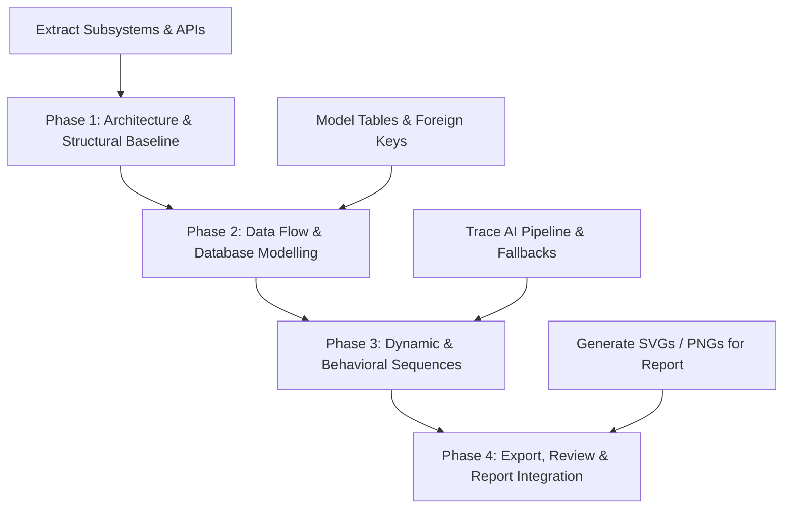
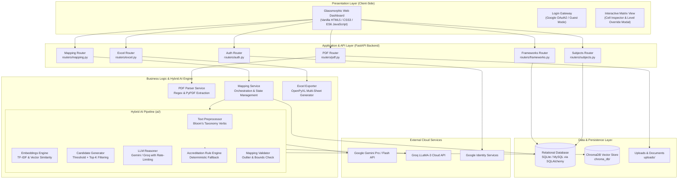
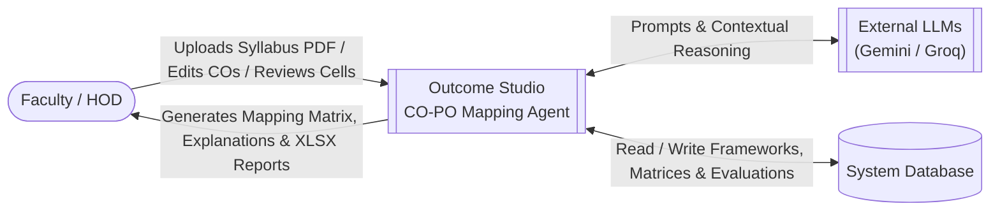
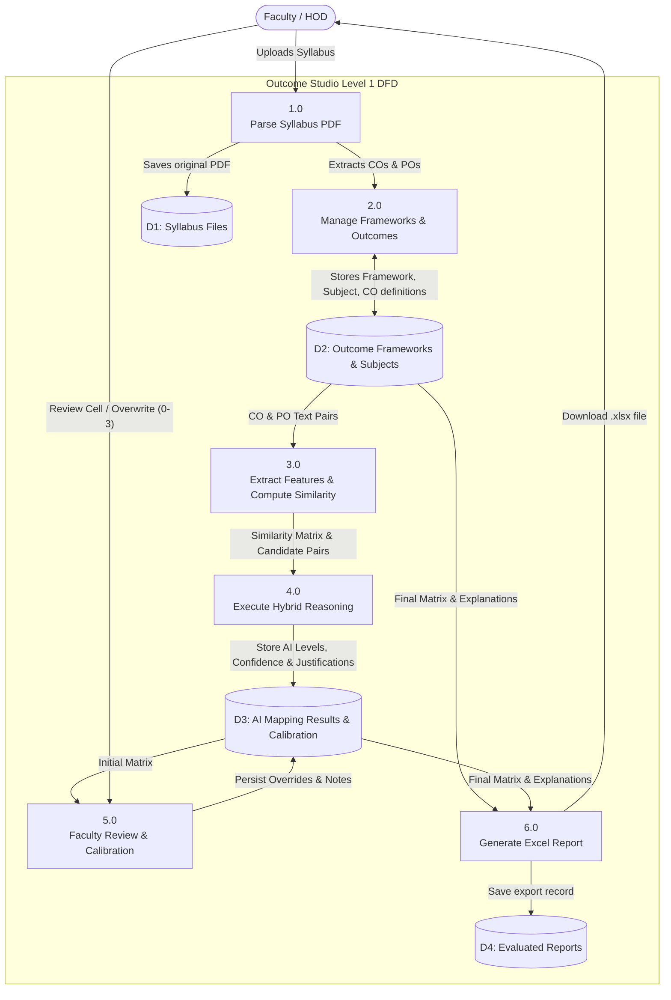
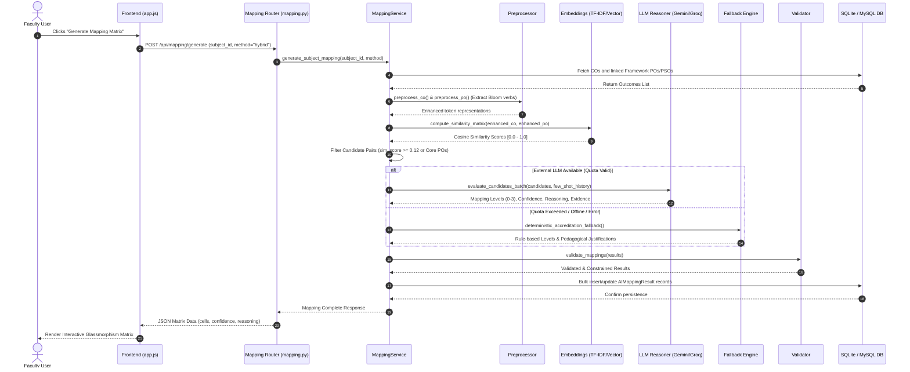
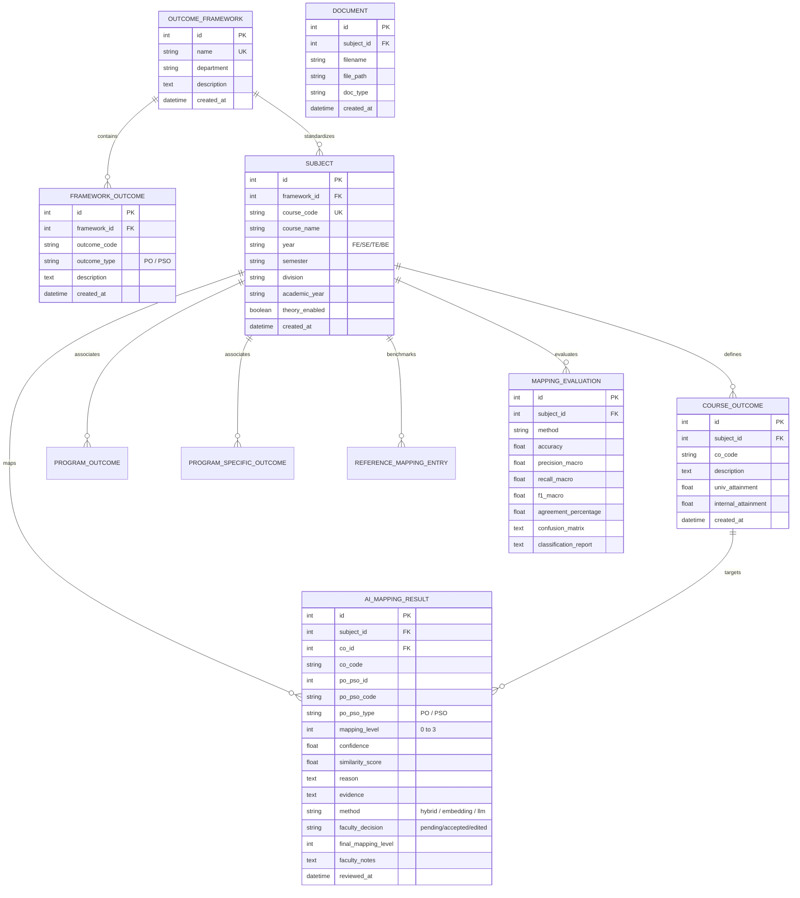
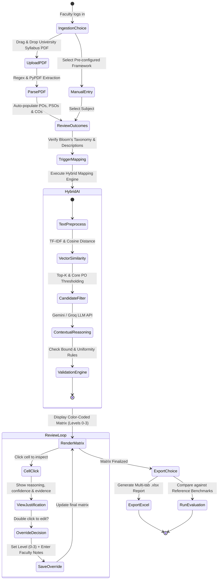
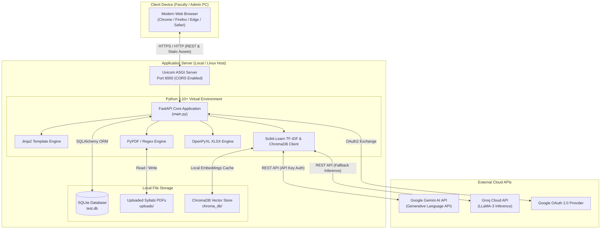

# System Diagrams Implementation Plan — Outcome Studio

This document provides a comprehensive implementation plan and ready-to-render system diagrams tailored specifically to the **Outcome Studio (AI CO–PO/PSO Mapping & Attainment Platform)** codebase.

---

## 📑 1. Diagram Requirements & Scope

For engineering capstone projects, academic reports (SPPU / AICTE / NBA), and technical documentation, the system is represented across four distinct viewpoints:

| Category | Diagram Name | Purpose in Outcome Studio | Primary Code References |
| :--- | :--- | :--- | :--- |
| **Structural** | **1. System Architecture (Layered)** | Multi-tier view from UI to AI engine and DB | [main.py](file:///home/atharv/Documents/BE_Project/main.py), [database.py](file:///home/atharv/Documents/BE_Project/database.py) |
| **Structural** | **2. Component Diagram** | Inter-module contracts & service dependencies | [routers/](file:///home/atharv/Documents/BE_Project/routers), [services/](file:///home/atharv/Documents/BE_Project/services), [ai/](file:///home/atharv/Documents/BE_Project/ai) |
| **Structural** | **3. Entity-Relationship (ER) Diagram** | Database relational schema & cardinalities | [models.py](file:///home/atharv/Documents/BE_Project/models.py), [schema.sql](file:///home/atharv/Documents/BE_Project/schema.sql) |
| **Behavioral** | **4. Data Flow Diagram (DFD Level 0 & 1)** | Transformation of syllabus PDF to mapped matrix | [services/pdf_parser.py](file:///home/atharv/Documents/BE_Project/services/pdf_parser.py), [ai/mapper.py](file:///home/atharv/Documents/BE_Project/ai/mapper.py) |
| **Behavioral** | **5. Sequence Diagram (Hybrid AI Mapping)** | Detailed invocation order: Vector + LLM + Fallback | [ai/mapper.py](file:///home/atharv/Documents/BE_Project/ai/mapper.py), [ai/llm_reasoner.py](file:///home/atharv/Documents/BE_Project/ai/llm_reasoner.py) |
| **Behavioral** | **6. Activity / Workflow Diagram** | End-to-end faculty-in-the-loop lifecycle | [routers/mapping.py](file:///home/atharv/Documents/BE_Project/routers/mapping.py), [frontend/static/app.js](file:///home/atharv/Documents/BE_Project/frontend/static/app.js) |
| **Physical** | **7. Deployment Diagram** | Server runtime, local vector store, external LLMs | [server.py](file:///home/atharv/Documents/BE_Project/server.py), `requirements.txt` |

---

## 🛠️ 2. Step-by-Step Implementation Plan

### Phase 1: High-Level Structural Modeling
- [x] Analyze codebase structure: FastAPI routers, services, AI coordinator, database layer.
- [x] Construct **High-Level Tiered Architecture**.
- [x] Construct **Component Interconnection Diagram**.

### Phase 2: Data & Storage Modeling
- [x] Map relational entities from [models.py](file:///home/atharv/Documents/BE_Project/models.py): `OutcomeFramework`, `Subject`, `CourseOutcome`, `AIMappingResult`, `MappingEvaluation`.
- [x] Generate **Entity-Relationship (ER) Diagram**.
- [x] Construct **Data Flow Diagram (Level 0 Context & Level 1 Functional)**.

### Phase 3: Process & Behavioral Modeling
- [x] Trace hybrid mapping flow: Preprocessing -> TF-IDF/ChromaDB -> Gemini/Groq LLM -> Accreditation Fallback -> Validation.
- [x] Trace Faculty Calibration Loop: Cell inspection, manual override, historical few-shot caching.
- [x] Generate **Sequence Diagram** and **Activity Diagram**.

### Phase 4: Output & Report Formatting
- Export Mermaid diagrams to high-resolution vector SVGs or PNGs for the BE Project Report / Thesis using Mermaid Live Editor or Mermaid CLI.

---

## 📐 3. System Diagrams Specification (Ready-to-Use)

### Diagram 1: Layered System Architecture
Shows the presentation layer, REST API gateways, hybrid AI engine, storage, and third-party AI providers.

---

### Diagram 2: Data Flow Diagram (DFD Level 0 & Level 1)

#### DFD Level 0 (Context Diagram)

#### DFD Level 1 (Functional Decomposition)

---

### Diagram 3: Sequence Diagram — Hybrid AI Mapping & Fallback Pipeline
Illustrates the exact lifecycle from when faculty clicks "Generate Matrix" to database persistence.

---

### Diagram 4: Entity-Relationship (ER) Diagram
Reflects the exact database schema from [models.py](file:///home/atharv/Documents/BE_Project/models.py).

---

### Diagram 5: Activity / Workflow Diagram (Faculty-in-the-Loop)
Shows the complete operational lifecycle from syllabus ingestion to accreditation export.

---

### Diagram 6: Deployment & Infrastructure Diagram
Shows runtime processes, networking, file storage, and external integrations.

---

## 🚀 4. How to Use & Export These Diagrams

1. **In Antigravity IDE / Markdown Viewers**: All code blocks above use native GitHub Flavored Markdown `mermaid` syntax, rendering automatically.
2. **In Draw.io / Diagrams.net**: Open Draw.io -> Click `Arrange` -> `Insert` -> `Advanced` -> `Mermaid` -> Paste the code block.
3. **Mermaid Live Editor**: Visit [mermaid.live](https://mermaid.live), paste any diagram block, and export directly as high-resolution PNG, SVG, or PDF for your project report.
4. **Command Line Generation**: Run `npx -y @mermaid-js/mermaid-cli -i system_diagrams_implementation_plan.md -o output/` to batch-convert all diagrams into standalone vector graphics.
